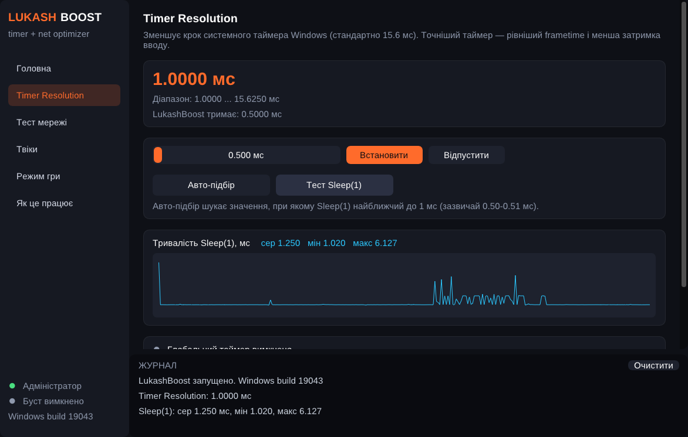

# LukashBoost — Timer Resolution + мережева оптимізація для ігор

Одна програма для Windows 10/11, яка поєднує **Timer Resolution** і **мережеву оптимізацію в стилі ExitLag** — але лише з тим, що *реально працює* на рівні операційної системи. Без фейкових «прискорювачів».




*Скриншоти зроблені у Wine, тому цифри таймера там не такі, як на справжній Windows (на Windows буде 0.5 мс і Sleep(1) ≈ 1 мс).*

Дві версії:
* **`LukashBoost.exe`** — графічний інтерфейс (сторінки: Головна, Timer Resolution, Тест мережі, Твіки, Режим гри, Як це працює; журнал дій унизу).
* **`LukashBoost-cli.exe`** — консольна версія з меню і командним рядком (для автозапуску/ярликів).

## Чесно про ExitLag

ExitLag зменшує пінг, пускаючи трафік гри **через свої сервери** (кращий маршрут + дублювання пакетів кількома шляхами). Це платна мережа серверів по всьому світу, і без неї жодна локальна програма не змінить маршрут твоїх пакетів в інтернеті. Будь-яка програма, яка обіцяє «-50 пінгу» без власних серверів, бреше.

LukashBoost робить усе, що можна зробити **на твоєму ПК**:

| Функція | Що реально дає |
|---|---|
| **Timer Resolution** (`NtSetTimerResolution`) | Точніші таймери Windows (0.5 мс замість 15.6 мс): рівніший frametime, менша затримка вводу |
| **Авто-підбір роздільності** | Шукає значення (0.50–0.52 мс), при якому `Sleep(1)` максимально близький до 1 мс |
| **Тест Sleep(1)** | Показує, що таймер дійсно змінився (видно цифрами) |
| **GlobalTimerResolutionRequests** | На Windows 11 без цього ключа роздільність діє лише на процес, що її задав. Ключ робить її глобальною — тоді вона діє і на гру |
| **Вимкнення power throttling** | Windows 11 ігнорує таймер від згорнутих вікон — програма це вимикає для себе, а для гри вимикає EcoQoS |
| **Вимкнення алгоритму Нейгла** | `TcpAckFrequency=1`, `TCPNoDelay=1` — TCP-пакети йдуть одразу (для ігор на TCP) |
| **NetworkThrottlingIndex / SystemResponsiveness** | Windows не обмежує обробку мережевих пакетів під час мультимедіа |
| **MMCSS для ігор** | Вищий пріоритет планувальника CPU/GPU для ігрових потоків |
| **QoS DSCP 46** для exe гри | Пакети гри стають у пріоритетну чергу (Wi‑Fi WMM і роутери з QoS це враховують — помітно, коли хтось інший качає/дивиться відео) |
| **Режим гри** | Чекає запуск гри → High пріоритет, без EcoQoS, тримає Timer Resolution поки гра працює |
| **Тест мережі** | ICMP- і TCP-ping: мін/сер/макс, джитер, втрати; порівняння кількох серверів з вибором найкращого |
| **Резервна копія і відкат** | Усі зміни реєстру зберігаються; пункт «Відкотити ВСІ зміни» повертає оригінальні значення |

## Як користуватися

1. Запусти `LukashBoost.exe` (сам попросить права адміністратора).
2. **Один раз:** сторінка **Твіки** → «Застосувати мережеві твіки»; сторінка **Timer Resolution** → «Увімкнути глобальний таймер» (Windows 11). Перезавантаж ПК.
3. **Тест мережі** — порівняй сервери (напр. IP серверів гри в різних регіонах) і вибери найкращий регіон у грі.
4. Перед грою: на **Головній** введи exe гри (напр. `cs2.exe`) і натисни **БУСТ**. Вікно можна згорнути — у згорнутому стані воно не малюється і не навантажує ПК.
5. Перевірити ефект: **Timer Resolution → Тест Sleep(1)**: без програми ~15.6 мс, з нею ~1.0 мс (видно на графіку).

### Командний рядок (`LukashBoost-cli.exe`)

```
LukashBoost-cli.exe --game cs2.exe --res 0.5 --qos     режим гри + QoS
LukashBoost-cli.exe --res 0.507                        просто тримати Timer Resolution
LukashBoost-cli.exe --ping 1.1.1.1 8.8.8.8 example.com:443 --count 30
LukashBoost-cli.exe --apply | --revert | --status
```

Можна покласти ярлик з `--game твоя_гра.exe` в автозавантаження.

## Збирання

* **GitHub Actions:** кожен push збирає обидва exe — завантаж їх у вкладці *Actions → build → Artifacts*.
* **Visual Studio:** `build.bat` з «x64 Native Tools Command Prompt», або `cmake -S . -B build && cmake --build build --config Release`.
* **Linux (MinGW):** `./build.sh`.

## Обмеження

* На Windows 10 версії 2004+ (але не 11) роздільність таймера діє лише на процес, який її задав; ключа `GlobalTimerResolutionRequests` там немає. Гра, якій потрібен точний таймер, зазвичай сама його запитує.
* QoS DSCP допомагає лише в межах твоєї мережі (Wi‑Fi, роутер). Провайдер і інтернет ці мітки зазвичай ігнорують.
* Вимкнення Нейгла впливає тільки на TCP. Більшість шутерів (CS2, Valorant, Fortnite) працюють на UDP, там головне — Timer Resolution, QoS і вибір сервера.

## Структура

* `src/core.*` — уся логіка (таймер, пінг, реєстр, режим гри)
* `src/gui.cpp` — графічний інтерфейс (Dear ImGui + DirectX 11)
* `src/console.cpp` — консольна версія
* `third_party/imgui` — [Dear ImGui](https://github.com/ocornut/imgui) 1.91.5 (MIT)
