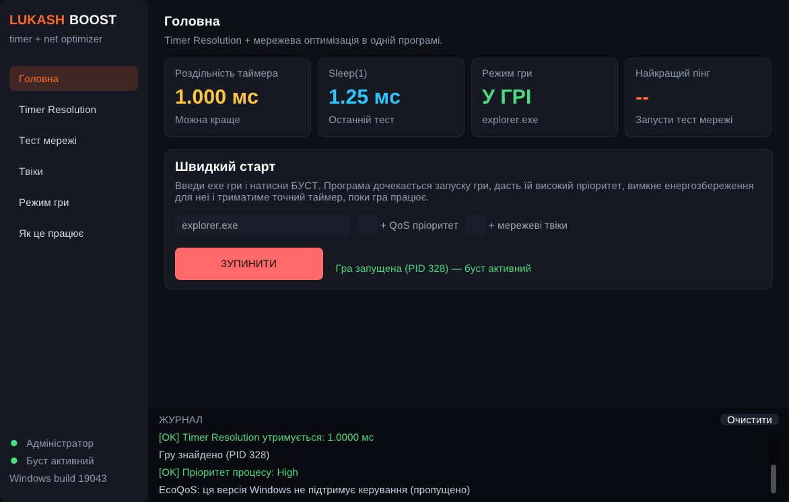
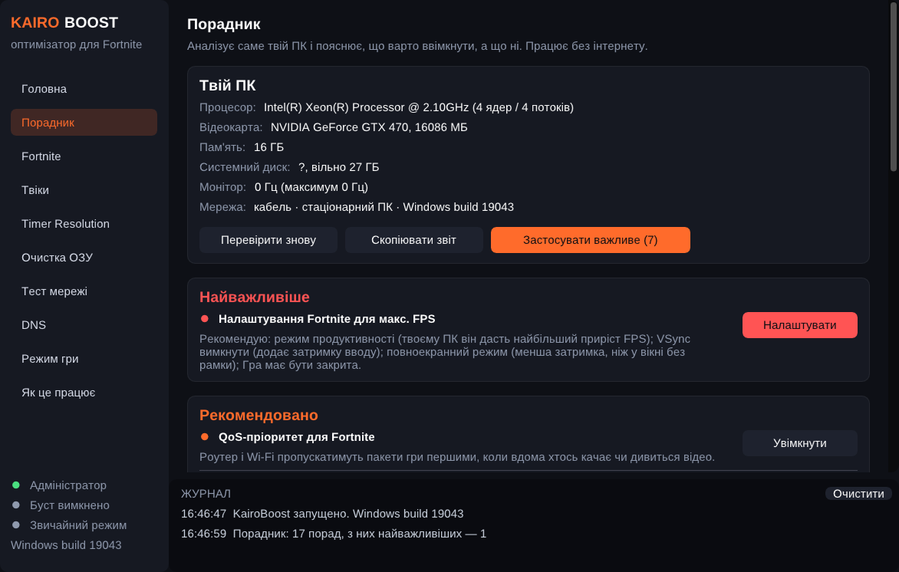
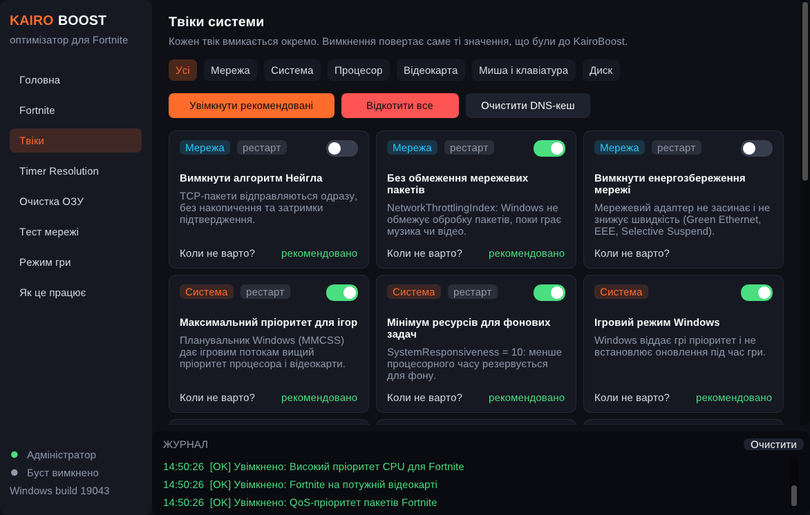
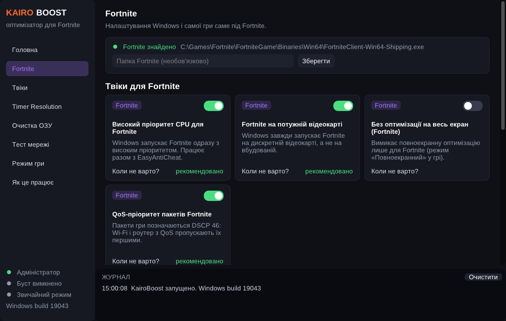
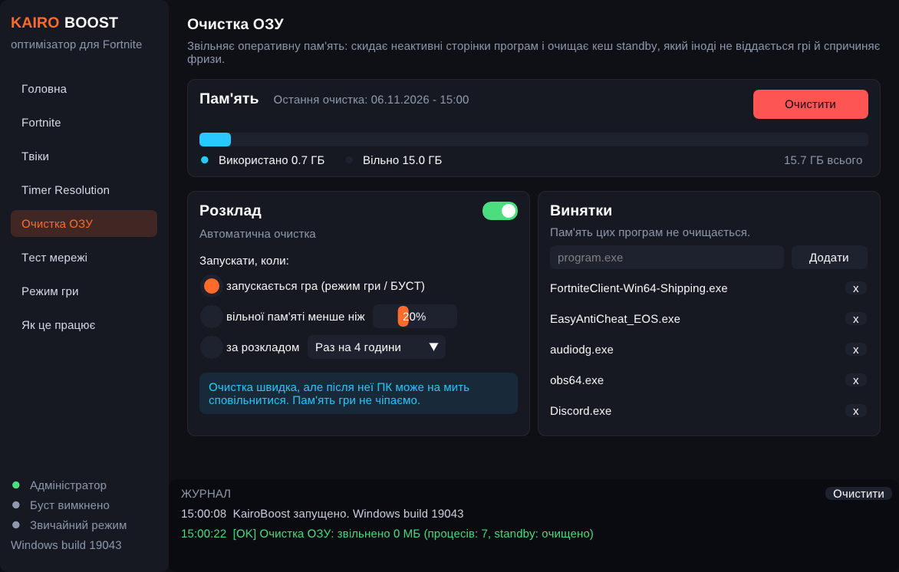

# KairoBoost — оптимізатор Windows для Fortnite

Timer Resolution, твіки Windows, налаштування Fortnite, очистка ОЗУ і тест пінгу — в одній програмі для Windows 10/11. Тільки те, що *реально працює* на рівні системи, і кожну зміну можна відкотити.







## ⬇ Завантажити

**[KairoBoost.exe](https://github.com/Monfyk/Lukash/releases/latest/download/KairoBoost.exe)** — пряме посилання на останню версію (усі версії — у [Releases](https://github.com/Monfyk/Lukash/releases)).

*Скриншоти зроблені у Wine, тому цифри таймера і пам'яті там не такі, як на справжній Windows.*

## Редакції

| Файл | Для кого |
|---|---|
| `KairoBoost.exe` | Особиста версія, налаштована під Fortnite |
| `KairoBoostPro.exe` | Версія для продажу: будь-яка гра — Fortnite, CS2, VALORANT, League of Legends, Apex, Call of Duty, Dota 2, Overwatch 2, Rocket League, Rainbow Six, PUBG, GTA V, Marvel Rivals, Tarkov, Roblox, Minecraft або своя гра (exe). Автопошук через Steam, Riot, Battle.net або запущений процес |
| `KairoBoost-cli.exe` | Консольна версія |

Обидві графічні версії збираються з одного коду (`src/edition.h`, прапорець `KB_SALE`).

## Чесно про пінг

Сервіси на кшталт ExitLag зменшують пінг, пускаючи трафік гри **через свої сервери** (кращий маршрут + дублювання пакетів). Без такої мережі серверів жодна програма на ПК не змінить маршрут в інтернеті. KairoBoost не обіцяє «-50 пінгу», а робить те, що можна зробити локально: стабільніший FPS, менша затримка вводу, пріоритет трафіку гри у твоїй мережі і вибір найкращого регіону Fortnite.

## Можливості

### Головна
* **БУСТ** — чекає запуску гри, тримає Timer Resolution, ставить пріоритет, автоматично чистить ОЗУ і згортає своє вікно.
* **Оптимізація в один клік** — вмикає всі безпечні рекомендовані твіки.

### Порадник
Аналізує саме твій ПК без інтернету: процесор і кількість ядер, відеокарти (дискретна/вбудована), обсяг і частоту пам'яті (виявляє вимкнений XMP/EXPO і одну планку), SSD/HDD і вільне місце, ноутбук/ПК і батарею, частоту монітора, кабель/Wi-Fi, версію Windows, налаштування Fortnite. Розкладає поради на «Найважливіше», «Рекомендовано», «Можна спробувати», «Уже добре» і «Не варто для твого ПК», з кнопками «Увімкнути» і «Застосувати важливе». «Скопіювати звіт» — щоб поділитися.

### Fortnite
* Автоматично знаходить гру (через Epic Games Launcher), можна вказати папку вручну.
* **Високий пріоритет CPU** через Windows (`Image File Execution Options`) — працює разом з EasyAntiCheat, який не дає змінювати пріоритет «на льоту».
* **Fortnite на дискретній відеокарті** (налаштування графіки Windows).
* **Без оптимізації на весь екран** лише для Fortnite.
* **QoS DSCP 46** для пакетів Fortnite.
* **Налаштування гри** (`GameUserSettings.ini`): обмеження FPS, VSync, режим продуктивності, повноекранний режим, мінімальна графіка (тіні, ефекти, постобробка; дальність огляду й текстури не чіпаються). Кнопка «Обрати все для макс. FPS». Перед зміною робиться копія, кнопка «Повернути як було».
* Попередження, якщо гра йде через Wi-Fi, і список того, що дає найбільший ефект поза програмою (NVIDIA Reflex, кабель, частота опитування миші).
* **Пінг до регіонів Epic** (EU, Німеччина, Франція, Британія, NA, BR, ME, ASIA, OCE) — і підказка, який регіон вибрати в грі.
* Очищення логів і звітів про збої.

### Твіки (кожен — окремий перемикач з поясненням і «Коли не варто вмикати?»)
| Категорія | Твіки |
|---|---|
| Мережа | Вимкнення Нейгла (лише TCP), без обмеження мережевих пакетів, вимкнення енергозбереження і модерації переривань мережевої карти |
| Система | MMCSS-пріоритет для ігор, мінімум ресурсів для фону, ігровий режим Windows, вимкнення фонового запису Game Bar, глобальний Timer Resolution (Windows 11), вимкнення SysMain (SuperFetch) |
| Процесор | Схема «Максимальна продуктивність», усі ядра активні (без паркування) |
| Відеокарта | Максимальна частота монітора, оптимізації для віконних ігор (Windows 11), апаратне планування GPU, вимкнення оптимізації на весь екран |
| Миша і клавіатура | Вимкнення прискорення миші, швидший повтор клавіш |
| Диск | Вимкнення індексації файлів, вимкнення міток останнього доступу NTFS |

**Повтор клавіш** (як FilterKeysSetter): повзунки затримки перед повтором (100–1000 мс) та інтервалу повтору (5–100 мс), пресети «Швидко / Дуже швидко / Максимум / Екстрим», тестове поле і кнопка «Стандарт Windows».

На кожній картці видно, коли твік починає діяти: одразу, після перезапуску гри або після перезавантаження ПК.

Вимкнення твіка повертає **саме ті значення, що були до KairoBoost** (зберігаються в `HKLM\SOFTWARE\KairoBoost`). «Відкотити все» повертає все разом.

### Timer Resolution
Встановлення і утримання 0.5 мс, авто-підбір значення під `Sleep(1)` ≈ 1 мс, тест точності з графіком.

### Очистка ОЗУ
Скидання робочих наборів процесів + очищення standby-кешу. Вручну або автоматично: при запуску гри, коли вільної пам'яті менше N %, або за розкладом. Список винятків (гра, античит, OBS, Discord тощо не чіпаються).

### Тест мережі
ICMP- і TCP-пінг до кількох серверів одночасно: мін/сер/макс, джитер, втрати, графік.

### DNS
* Справжні DNS-запити до Cloudflare, Quad9, NextDNS, Google, Comodo Secure, AdGuard, OpenDNS, Control D і DNS провайдера — середній час відповіді, позначка «найшвидший».
* «Вибрати» встановлює DNS (IPv4 і IPv6) на всіх активних підключеннях; «Повернути як було» відновлює попередні налаштування.
* Визначає, чи мережа **перехоплює DNS** (провайдер, роутер, антивірус) — тоді попереджає, що зміна DNS нічого не дасть.
* DNS впливає на відкриття сайтів, вхід у лаунчер і підключення до матчу, але не на пінг у самій грі.

### Трей
Хрестик ховає KairoBoost у трей біля годинника — буст, таймер і очистка ОЗУ працюють далі. Клік по значку відкриває вікно, «Вихід» у меню значка закриває програму повністю. Повторний запуск exe просто відкриває вже запущену програму. Можна вимкнути на головній сторінці.

## Програма сама майже не їсть ресурсів
* Вікно перемальовується лише коли є ввід (у спокої ~15 к/с, у фоні ~4 к/с, під час гри — 1 к/с).
* Згорнуте вікно не малюється взагалі; за замовчуванням KairoBoost **сам ховається в трей, коли запускається гра**.
* Під час гри програма переходить в **економний режим**: нижчий пріоритет, режим ефективності Windows (EcoQoS / E-ядра), скидає свою пам'ять, не опитує реєстр. Timer Resolution при цьому продовжує діяти.
* Режим гри чекає на процес гри через системне очікування — 0 % CPU, поки гра запущена.

## Як користуватися

1. Запусти `KairoBoost.exe` (сам попросить права адміністратора).
2. **Головна → Оптимізувати**, потім сторінка **Fortnite** — перевір, що гру знайдено, і налаштуй FPS/режим продуктивності (при закритій грі). Перезавантаж ПК.
3. **Fortnite → Перевірити регіони** — і вибери найкращий у грі: *Налаштування → Гра → Регіон підбору гравців*.
4. Перед грою: **Головна → БУСТ**. Можна закрити очі на вікно — воно згорнеться саме.

### Консольна версія (`KairoBoost-cli.exe`)

```
KairoBoost-cli.exe                                   меню
KairoBoost-cli.exe --game --clean-ram                режим гри для Fortnite + очистка ОЗУ на старті
KairoBoost-cli.exe --apply-recommended               рекомендовані твіки
KairoBoost-cli.exe --revert-all                      відкотити все
KairoBoost-cli.exe --fortnite-ping                   пінг до регіонів Fortnite
KairoBoost-cli.exe --ping 1.1.1.1 example.com:443    тест серверів
KairoBoost-cli.exe --dns-test | --dns Cloudflare | --dns-auto
KairoBoost-cli.exe --status | --clean-ram | --res 0.5
```

## Безпека
KairoBoost не читає і не змінює пам'ять чи файли гри (окрім стандартного файлу налаштувань `GameUserSettings.ini`) — лише налаштування Windows, які можна змінити й вручну.

## Збирання
* **GitHub Actions:** кожен push збирає обидва exe — *Actions → build → Artifacts*.
* **Visual Studio:** `build.bat` з «x64 Native Tools Command Prompt» або `cmake -S . -B build && cmake --build build --config Release`.
* **Linux (MinGW):** `./build.sh`.

## Структура
* `src/core.*` — таймер, реєстр з бекапом, служби, пам'ять, пінг, режим гри
* `src/tweaks.*` — каталог твіків
* `src/fortnite.*` — пошук гри, налаштування, регіони
* `src/dns.*` — тест і вибір DNS
* `src/games.*` — підтримувані ігри, пошук гри, обрана гра
* `src/advisor.*` — порадник
* `src/gui.cpp` — графічний інтерфейс (Dear ImGui + DirectX 11)
* `src/console.cpp` — консольна версія
* `third_party/imgui` — [Dear ImGui](https://github.com/ocornut/imgui) 1.91.5 (MIT)
